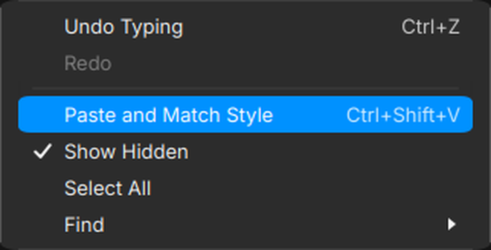
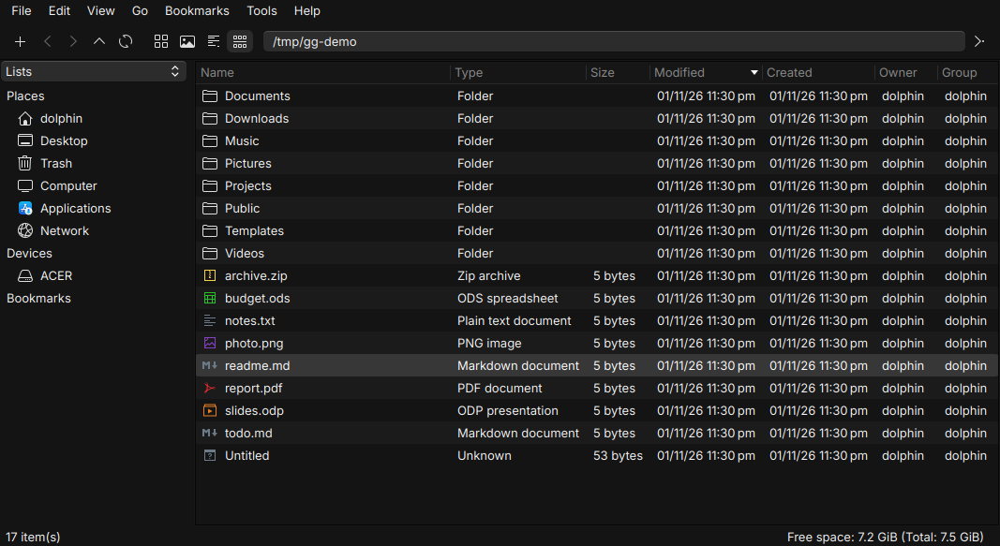

# Golden Gate LXQt Theme

A macOS-inspired desktop theme for **LXQt / Lubuntu**, with a top menu bar, bottom dock,
traffic-light window controls, frosted window switcher, rounded menus and consistent application styling.

| Menu bar | Dock |
|---|---|
|  |  |

| Window controls | Menus |
|---|---|
|  |  |



## What you get

| Piece | What it does | Installed by |
|---|---|---|
| **Qt apps (Kvantum)** | dark surfaces, rounded accent highlights, tick marks instead of check boxes, glass menu with light rim, PCManFM-Qt list stripes / dimmed header / dark location bar | `install.sh` |
| **GTK apps** | `WhiteSur-Dark-Black` (built from WhiteSur-Dark with a darker palette), menu rim, tick marks | `install.sh` |
| **Window decoration (Openbox)** | 32/33 px title bar, traffic-light window controls, light 1 px border | `install.sh` |
| **LXQt theme + fonts** | icon theme, UI font Inter 10 pt, monospace Maple Mono NF | `install.sh` |
| **Window switcher** | large icons, selected app label, frosted background | `install.sh` |
| **picom** | rounded windows (17 px), menus (14 px), shadows, blur | `install.sh` |
| **Menu bar** | 34 px top panel: start icon, tray, one-line clock | `dock.sh` |
| **Dock** | 6 pinned apps: files (PCManFM-Qt), browser, settings, trash, download manager, IDE | `dock.sh` |

The desktop look (`install.sh`) and the menu bar + dock (`dock.sh`) are **separate elements**; use either or both.

## Requirements

Tested on **Lubuntu 26.04** (LXQt 2.3, Qt 6, Openbox 3.6, picom 12.5). Debian/Ubuntu-family package names:

| Need | Package / source |
|---|---|
| LXQt session with Openbox, panel, file manager | `lxqt`, `openbox`, `lxqt-panel`, `pcmanfm-qt`, `lxqt-themes` |
| Window switcher (icons style) | `python3-pyqt6`, X11 (`libx11-6`) |
| Compositor | `picom` |
| Qt style | `qt5-style-kvantum`, `qt6-style-kvantum` (and optionally `qt5-style-kvantum-themes`) |
| Build tools used by the scripts | `python3`, `curl`, `unzip`, `git`, `fontconfig`, `x11-utils`, `libglib2.0-bin`, `libglib2.0-dev-bin`, `libgtk-3-bin` |
| **WhiteSur GTK theme** (base for `WhiteSur-Dark-Black`) | [vinceliuice/WhiteSur-gtk-theme](https://github.com/vinceliuice/WhiteSur-gtk-theme) |
| **WhiteSur icon theme** (dock icons, UI icons) | [vinceliuice/WhiteSur-icon-theme](https://github.com/vinceliuice/WhiteSur-icon-theme) |
| UI font **Inter** | **bundled** (SIL OFL 1.1), installed automatically if missing |
| Mono font **Maple Mono NF** | downloaded (checksum-verified) by `install.sh` |

The scripts **detect what is missing** and tell you the exact command. Add `--install-deps` to let them do it
(`sudo apt install …`, plus cloning and installing the two WhiteSur themes into your home directory).

### Installing the WhiteSur dependencies by hand

```bash
# GTK theme (installs into ~/.themes; use -c Light as well if you want the experimental light mode)
git clone --depth 1 https://github.com/vinceliuice/WhiteSur-gtk-theme.git
(cd WhiteSur-gtk-theme && ./install.sh -c Dark -o normal)

# Icon theme (installs into ~/.local/share/icons: WhiteSur, WhiteSur-light, WhiteSur-dark)
git clone --depth 1 https://github.com/vinceliuice/WhiteSur-icon-theme.git
(cd WhiteSur-icon-theme && ./install.sh)

# Qt style + build tools
sudo apt install qt5-style-kvantum qt6-style-kvantum picom openbox python3-pyqt6 lxqt-themes \
                 libglib2.0-bin libglib2.0-dev-bin libgtk-3-bin x11-utils python3 curl unzip git
```

## Install

```bash
git clone <this repo> golden-gate-lxqt-theme && cd golden-gate-lxqt-theme

./install.sh --dry-run            # see what would happen (nothing is changed)
./install.sh --install-deps       # desktop look: Qt, GTK, Openbox, LXQt, picom, fonts, window switcher
./dock.sh                         # menu bar + dock (separate element)
```

Log out and back in once so every Qt/GTK app picks up the new styling. Every file that is replaced is
backed up first: undo everything with `./restore.sh all` (or just the last run with `./restore.sh`).

Useful flags: `--only kvantum,gtk` / `--skip fonts`,
`--no-restart`, `-y`, `--pcmanfm-detailed`. Dock: `--menubar-only`, `--dock-only`.

## Configuration

Settings live in **`config/theme.json`**. Copy `config/theme.default.json` or use the configuration wizard:

```bash
./install.sh --configure     # interactive: mode, accent, window border, radius, menu rim, fonts, dock apps
python3 lib/theme.py validate
```

| Key | Default | Meaning |
|---|---|---|
| `mode` | `dark` | `dark` or `light` (**light is experimental**) |
| `accent` | `auto` | `auto` (the mode’s default accent) or `#rrggbb` |
| `window.border.enabled / width` | `true / 1` | window border; width `0` makes the title bar exactly 32 px, with a border Openbox makes it 33 px |
| `window.border.active_color / inactive_color` | `auto` | `auto` = white 23 % / 14 % in dark mode, black in light mode, or `#rrggbb` |
| `window.corner_radius` | `17` | window corner radius in pixels |
| `window.titlebar_font_size` | `10` | pt |
| `menu.rim` / `menu.corner_radius` | `true / 14` | thin light edge on menus / radius |
| `fonts.ui`, `fonts.ui_size`, `fonts.mono` | `Inter`, `10`, `Maple Mono NF` | UI font, point size and monospace font |
| `switcher.style / opacity` | `icons / 67` | icon overlay or Openbox list; background opacity in percent |
| `dock.backend` | `lxqt-panel` | `lxqt-panel` or `plank`; Plank supports a translucent background with opaque icons |
| `menubar.enabled / height / clock_format` | `true / 34 / "ddd MMM d  h:mm AP"` | menu bar |
| `dock.enabled / icon_size / width / apps / custom` | `true / 36 / auto / [...]` | apps: `files browser settings trash downloads ide`; `custom` takes `{"name","exec","icon"}` |

Re-run `./install.sh` / `./dock.sh` after editing. Dark/light borders are deliberately configurable:
a *dark* border on a dark theme does not read as an outline, so the default is a light hairline.

## Known limitations

- **No global menu**: LXQt's panel has no host for the focused app's File/Edit menus, so they stay inside windows.
- Kvantum controls menu row height and selection shapes, so some spacing differs between Qt and GTK applications.
- If a PCManFM-Qt window opened by a restarted desktop process is blank, log out and back in.

## Window switcher

The `switcher` module installs a native Qt/X11 Alt+Tab overlay with 88 px icons,
108 px tiles, 20 px outer padding, a rounded selection highlight, and a label only
under the selected app. The overlay has a light frosted background. Background opacity is independent of icon/text opacity: icons stay vivid.
Picom supplies background blur. The overlay uses EWMH window activation and includes
windows from all desktops, excluding desktop and panel windows.

Apply with `./install.sh --only switcher,picom`. Alt+Tab cycles forward,
Alt+Shift+Tab backward; releasing Alt selects and Escape cancels. Set
`switcher.style` to `list` and rerun to restore Openbox's original shortcuts.
Every installed file is backed up and can be restored with `./restore.sh`.

The `plank` dock backend supports a native translucent surface with opaque icons.
The LXQt panel backend remains available for panel-based layouts.

## Licenses and credits

Scripts and configuration: MIT (see `LICENSE`). Bundled and derived third-party material, including
**Inter (SIL OFL 1.1)** and the GPL-3.0-derived Kvantum theme, is listed in [`THIRD_PARTY.md`](THIRD_PARTY.md).
"macOS" and "Golden Gate" are Apple trademarks / product names; this project is not affiliated with or
endorsed by Apple. WhiteSur is by vinceliuice.
