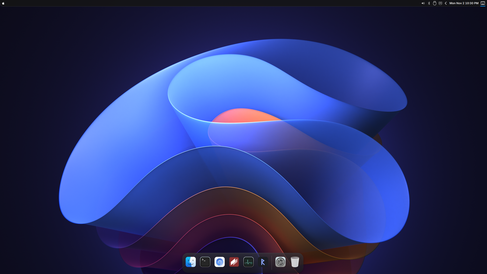
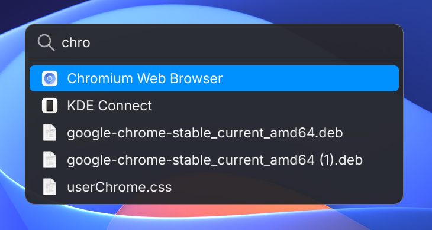
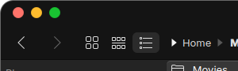

# Darwin Theme: a dark, translucent desktop theme for KDE Plasma 6 and LXQt

**Darwin Theme** gives a Linux desktop a clean, polished, Mac-like look. Its name nods to
Darwin, the open-source system underneath the Mac, the way WhiteSur nods to Big Sur. It works on
**KDE Plasma 6** (Wayland and X11) and on **LXQt / Lubuntu**. It gives you a slim
top bar, a floating **dock with icon magnification**, a **Spotlight-style search
launcher** (apps, files, calculator and currency), an **Alt+Tab switcher** with one icon per
window, traffic-light window buttons, rounded windows, and the WhiteSur icons and Inter font.

One command installs it, every change is backed up, and one command undoes it.

## Screenshots

### KDE Plasma 6



| Top bar (left and right ends) |
|---|
|  |

| Dock | Dock while hovering (magnification) |
|---|---|
|  |  |

| Search launcher (Super + Space) | Window buttons |
|---|---|
|  |  |

### LXQt / Lubuntu

| Menu bar | Dock |
|---|---|
|  |  |

| Window controls | Menus |
|---|---|
|  |  |


Dock zoom on LXQt (the icon under the pointer grows):


## Contents

- [Features](#features)
- [Requirements and tooling](#requirements-and-tooling)
- [Install](#install)
- [Using it](#using-it)
- [Settings](#settings)
- [Undo and backups](#undo-and-backups)
- [How it works](#how-it-works)
- [Performance](#performance)
- [Testing](#testing)
- [Troubleshooting](#troubleshooting)
- [Questions and answers](#questions-and-answers)
- [Known limits](#known-limits)
- [Contributing](#contributing)
- [License](#license)

## Features

| | KDE Plasma 6 | LXQt / Lubuntu |
|---|---|---|
| Top bar | Apple-style launcher icon, app menu, one-line clock, short tray with a `<` arrow for the rest. Square top corners, curved bottom corners | Launcher, tray and clock |
| Dock | Floating dock with smooth icon magnification, your pinned apps kept in order | Plank dock with magnification |
| Search launcher | Qt launcher: apps, files, calculator, currency | rofi launcher: apps, files, calculator |
| Alt+Tab | Dark or light glass switcher, one icon per window, name under the selected icon | Same style |
| Windows | Traffic-light buttons, rounded corners | Traffic-light buttons, rounded corners (picom) |
| Look | Dark palette, blue accent, WhiteSur icons and GTK theme, Inter and Maple Mono NF fonts | Same |

Keyboard shortcuts (both desktops):

| Keys | Action |
|---|---|
| **Super + Space** | Search apps (calculations and currency show at the top) |
| **Super + Shift + Space** | Search files |
| **Super + Ctrl + Space** | Calculator and currency |
| **Alt + Tab** | Switch windows |

## Requirements and tooling

The installer works with what you already have. If an optional tool is missing, it
skips that feature, says so, and carries on.

### KDE Plasma 6

**Needed (all part of a normal Plasma 6 install):**

| Tool | Used for |
|---|---|
| `plasmashell`, `kwin` (Plasma 6) | Panels, windows and effects |
| `qdbus6` | Talking to Plasma and KWin |
| `plasma-apply-colorscheme`, `plasma-apply-desktoptheme` | Applying colours and the Plasma style |
| `systemctl --user` | Restarting only the Plasma panel process when needed |
| Python 3.10 or newer | The installer |
| `fontconfig` (`fc-cache`, `fc-list`) | Registering fonts |

**Optional (installed by `./install.sh --install-deps` where possible):**

| Tool | Feature it adds | Ubuntu / Debian package |
|---|---|---|
| Kvantum | Dark Qt widget style | `qt6-style-kvantum` |
| PyQt6 | The Spotlight-style launcher (without it, KRunner is used) | `python3-pyqt6` |
| WhiteSur GTK and icon themes | Icons and GTK app styling | fetched from [WhiteSur-gtk-theme](https://github.com/vinceliuice/WhiteSur-gtk-theme) and [WhiteSur-icon-theme](https://github.com/vinceliuice/WhiteSur-icon-theme) |
| Maple Mono NF | Code font | downloaded with a checksum |
| [KDE-Rounded-Corners](https://github.com/matinlotfali/KDE-Rounded-Corners) | Rounded bottom window corners (the top corners are always rounded) | built from source: `git cmake g++ extra-cmake-modules kwin-dev qt6-base-private-dev qt6-base-dev-tools libkf6kcmutils-dev` |
| `gsettings`, `gdbus` | GTK dark mode, registering the shortcuts | `libglib2.0-bin` |
| `kscreen-doctor` | Sizing the dock to your screen | part of Plasma |
| `plocate` or Baloo | File search | `plocate` |
| `qalc` | Units and functions in the calculator | `qalc` |

Currency conversion needs nothing extra: it uses the free European Central Bank daily
rates and remembers them for 12 hours. Package names on other distributions differ.

### LXQt / Lubuntu

Lubuntu 26.04 or LXQt 2.3, with Openbox and **picom 12 or newer**. The package list is in
[docs/LXQT.md](docs/LXQT.md), and `./install.sh --desktop lxqt --install-deps` installs it.

## Install

```bash
git clone https://github.com/prashantjain25/darwin-theme.git
cd darwin-theme
./install.sh --dry-run        # shows what would change, changes nothing
./install.sh                  # installs the theme
```

- Run it from your normal desktop session, **not with `sudo`**. It asks for `sudo` only
  when it must install a package, and only if you pass `--install-deps`.
- Your existing files are backed up first.
- Reopen your applications afterwards.

The installer detects the desktop you are logged into. To choose yourself (for example
over SSH): `./install.sh --desktop kde` or `./install.sh --desktop lxqt`.

Useful options:

```bash
./install.sh --install-deps       # also fetch missing themes, fonts and the rounded-corners effect
./install.sh --skip-panels        # colours and fonts only; leave the top bar and dock alone
./install.sh --no-restart         # write the files without reloading the desktop
./dock.sh --dock-mode auto-hide   # dock behaviour: auto-hide, reserve, always-on-top, intelligent-hide
./dock.sh --menubar-only          # change only the top bar
```

## Using it

- **Dock:** hover to magnify. Click to open or switch to an app. Middle-click or
  Shift-click opens a new window. The trash opens the trash folder.
- **Search launcher:** press **Super + Space** and type. An arithmetic or currency
  question such as `12*(3+4)` or `100 usd to eur` shows its answer at the top; press
  Enter to copy it. File matches appear under the apps.
- **Tray:** click the `<` arrow to see the hidden icons.
- **Dock settings:** open the dock widget's Configure page (Plasma panel edit mode). You can set the icon size,
  magnification, the running-app dots (off by default) and the trash.

## Settings

Copy `config/theme.default.json` to `config/theme.json` and change what you need, or run:

```bash
python3 lib/theme.py configure    # guided setup
python3 lib/theme.py validate     # check your file
```

| Setting | What it does |
|---|---|
| `mode` | `dark` (fully supported on KDE) or `light` (experimental) |
| `accent` | Highlight colour: `auto` or a colour such as `#0088ff` |
| `fonts.ui`, `fonts.ui_size`, `fonts.mono` | Interface font, its size, and the code font |
| `window.corner_radius` | How round the windows are |
| `menubar.enabled`, `menubar.height` | Top bar on or off, and its height |
| `menubar.hidden_tray_items`, `menubar.shown_tray_items` | Tray icons to always hide, or (KDE) to keep visible |
| `dock.enabled`, `dock.mode`, `dock.icon_size` | Dock on or off, hiding behaviour, icon size |
| `switcher.style` | `icons` (new switcher) or `list` (plain text list, LXQt) |

Use `THEME_CONFIG=/path/to/file` to read settings from somewhere else. Some options apply
to one desktop only; the other desktop ignores them.

## Undo and backups

```bash
./restore.sh                      # undo the newest installation
python3 lib/kde.py status         # KDE: what is installed, and where the backups are
./restore.sh --desktop lxqt --list
```

Backups live in `~/.local/state/darwin-theme/` (KDE) and
`~/.local/share/golden-gate-lxqt-theme/` (LXQt). Restoring on KDE restarts only the Plasma
panel process; your windows keep running.

## How it works

```
install.sh / dock.sh / restore.sh      pick the right desktop and run its setup
├─ lib/desktop.py                      works out whether you are on KDE or LXQt
├─ lib/kde.py                          KDE installer: files, settings, panels, backup and restore
├─ lib/kde_components.py               KDE shortcut registration helpers
├─ install-lxqt.sh, dock-lxqt.sh, restore-lxqt.sh   the tested LXQt setup (kept unchanged)
├─ lib/theme.py, palettes/             shared settings, colours and the light/dark palette
└─ assets/
   ├─ aurorae/, plasma/, color-schemes/ KDE window frames, panel style and colours
   ├─ plasmoids/…darwin.dock/       the dock (a Plasma widget)
   ├─ tabbox/                           the Alt+Tab switcher
   ├─ spotlight/                        the search launcher
   ├─ icons/Darwin-Icons/           small icon overlay (tray arrows) on WhiteSur
   ├─ layout.js                         builds the top bar and dock panels
   └─ kvantum/, gtk/, fonts/, …         Qt and GTK styling, fonts
```

Each install is recorded so it can be undone exactly. The KDE installer changes only your
own files, never system files, and refuses to touch anything outside your config and data
folders.

## Performance

Measured on Plasma 6.6, Wayland, 2560×1440:

| Action | Time |
|---|---|
| Repeat install (nothing to change) | about 2 seconds |
| Files-only install | about 0.35 seconds |
| Search launcher ready after pressing the shortcut | about 0.16 seconds |
| Search launcher answering a keystroke | about 0.14 milliseconds |
| Application list when opening the launcher | 5 milliseconds (351 ms on the very first run) |

How: environment checks run once and are remembered, the Plasma panel process restarts
only when its settings actually change, the colour scheme and Plasma style are re-applied
only when their files change, the app list is cached until a `.desktop` file changes,
file and currency lookups run in the background after you stop typing, and the dock sorts
its icons once per burst of changes.

## Testing

```bash
python3 -m unittest discover -s tests -v
bash -n install.sh dock.sh restore.sh install-lxqt.sh dock-lxqt.sh restore-lxqt.sh
```

The tests check desktop detection, that the LXQt scripts are unchanged, the KDE files,
that install and restore put every file back, the launcher, and the missing-tool paths.
They do not change your desktop. Display-based checks are described in
[CONTRIBUTING.md](CONTRIBUTING.md).

## Troubleshooting

| Problem | What to do |
|---|---|
| Panels disappeared after several installs in a row | `systemctl --user reset-failed plasma-plasmashell.service && systemctl --user start plasma-plasmashell.service` |
| The dock is not visible | It hides by default. Move the pointer to the bottom edge, or run `./dock.sh --dock-mode always-on-top` |
| **Super + Space** does nothing | Another program may own that key. The installer warns about conflicts. Check System Settings, Shortcuts |
| Bottom window corners are square | Install the rounded-corners effect: `./install.sh --install-deps` |
| Some app icons look wrong | Reopen the app. Check that `WhiteSur-dark` is installed |
| You want everything back | `./restore.sh` |

## Questions and answers

**Is there a Mac-like theme for KDE Plasma 6?**
Yes. This project is one. It covers the top bar, dock, search launcher, Alt+Tab, window
frames, icons and fonts, and works on Wayland.

**How do I get a dock with icon magnification on KDE Plasma 6?**
Install this theme. The dock is a Plasma widget that uses the normal task backend, so
your pinned apps and open windows work as usual.

**Is there a Spotlight alternative for KDE?**
The theme includes one: Super + Space searches apps, files, calculations and currency.

**Does it work on Kubuntu, Fedora KDE, openSUSE, Arch or Lubuntu?**
It is tested on Ubuntu-based systems with Plasma 6.6 and on Lubuntu. Other distributions
should work if they have the tools above, but they are not tested. Please tell us how it goes.

**Does it include Apple fonts or logos?**
No. It uses Inter, WhiteSur and its own artwork. The launcher icon comes from the
WhiteSur icon theme that the installer downloads.

**Can I go back?**
Yes. `./restore.sh` puts your files back exactly as they were.

## Known limits

- Some apps draw their own title bars (for example Chromium and some GTK apps) and the
  theme cannot restyle those.
- Global menus work only in apps that support them.
- On KDE, Plasma-themed surfaces (the top bar and Plasma pop-ups) have no background blur.
  Turning it on would blur a box around the floating dock.
- The KDE tray arrow sits after the icons, not before them as on a Mac.
- Light mode is experimental on LXQt and not yet available on KDE.
- Nothing from Apple is included.

## Contributing

Please read [CONTRIBUTING.md](CONTRIBUTING.md) first. It explains the rules, how to run the
tests, and how to report a problem.

## License

Scripts and artwork written for this project: MIT. The WhiteSur-based Kvantum styles stay
under **GPL-3.0** (`LICENSES/GPL-3.0.txt`). Inter stays under the **SIL Open Font License
1.1**. See [LICENSE](LICENSE) and [THIRD_PARTY.md](THIRD_PARTY.md).

This is an independent project and is not affiliated with Apple.
